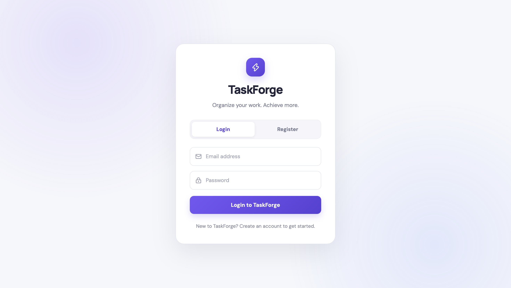
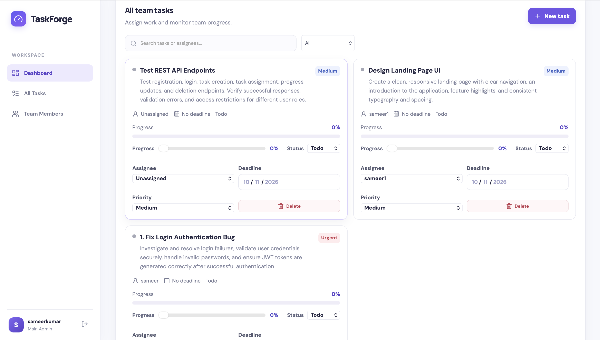
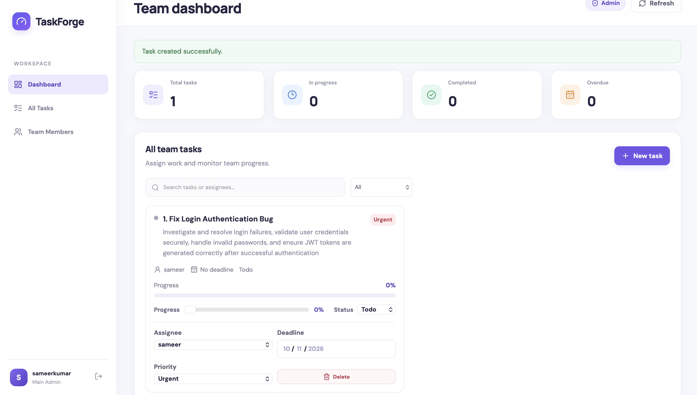
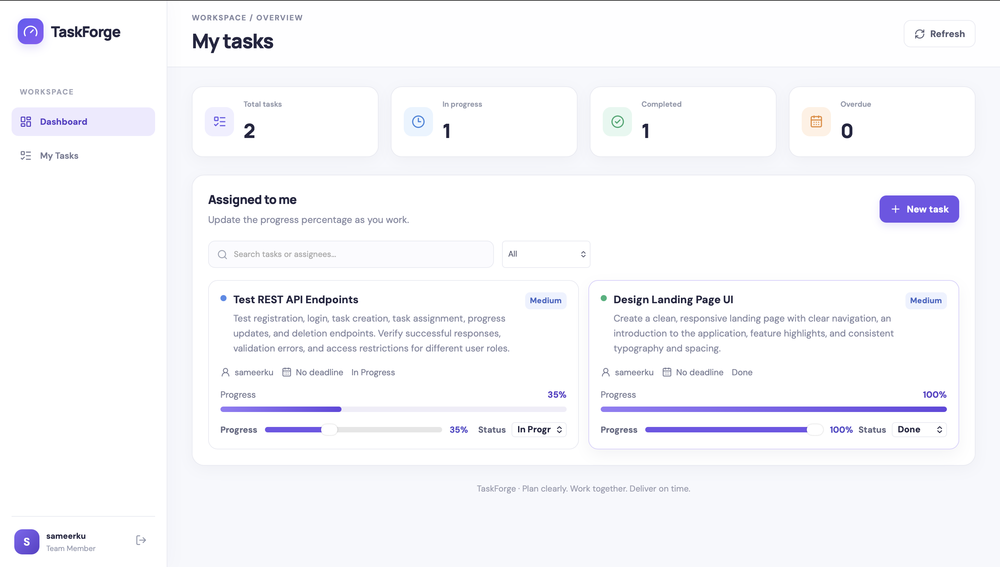

# TaskForge

**TaskForge** is a full-stack team task management application built to help teams organize tasks, assign responsibilities, track progress, and manage deadlines.

## Features

- User registration and login
- Role-based access for administrators and team members
- Create, assign, and manage tasks
- Set task priorities and due dates
- Track task progress and status
- Admin dashboard with task and team overview
- REST API built with FastAPI
- React and TypeScript frontend
- SQLite database

## Tech Stack

**Frontend**
- React
- TypeScript
- Vite
- CSS

**Backend**
- Python
- FastAPI
- SQLAlchemy
- SQLite
- JWT authentication

## Project Structure

```text
TaskForge/
├── backend/
│   ├── auth.py
│   ├── database.py
│   ├── main.py
│   ├── models.py
│   └── requirements.txt
├── frontend/
├── .gitignore
└── README.md
```
## Screenshots

## Screenshots

### Login Page


### Admin Dashboard


### Task Management


### Member Dashboard


## Getting Started

### 1. Clone the repository

```bash
git clone https://github.com/YOUR_USERNAME/TaskForge.git
cd TaskForge
```

Replace `YOUR_USERNAME` with your GitHub username.

### 2. Set up the backend

```bash
cd backend
python3 -m venv venv
source venv/bin/activate
pip install -r requirements.txt
```

Configure the required environment variables for authentication, including a strong `TASKFORGE_SECRET_KEY`. Set `TASKFORGE_ADMIN_EMAIL` to the email address intended for the administrator account.

Start the backend:

```bash
uvicorn main:app --reload
```

API documentation is available at `http://127.0.0.1:8000/docs`.

### 3. Set up the frontend

Open a second terminal:

```bash
cd frontend
npm install
npm run dev
```

Open the local URL displayed by Vite, usually `http://localhost:5173`.

## Security Notes

- Keep secret keys and environment files private.
- Do not commit local databases, virtual environments, or `node_modules`.
- Use a strong, unique JWT secret in your environment.
- Configure administrator access carefully.

## Project Status

Developed as a full-stack learning project focused on task management, authentication, and role-based access control.